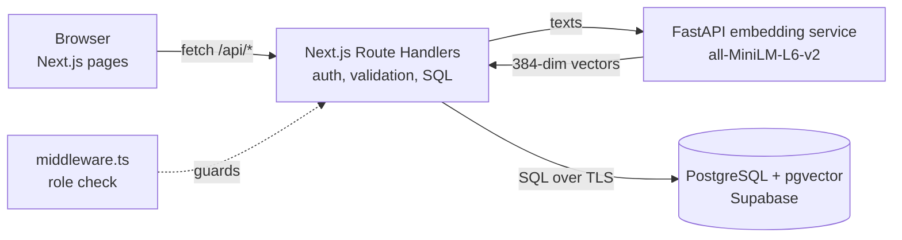

# NoteVault

Semantic search over your own course notes. Upload PDFs, `.txt` and `.md` files; NoteVault splits them into chunks, embeds each chunk with `all-MiniLM-L6-v2`, and lets you search by meaning, by keyword, or both.

**DBMS Level 3 project** · PES1UG24CS166 Gagan P · PES1UG24CS156 Dhruva Myakeri

| Layer | Technology |
| --- | --- |
| Frontend | Next.js 14 (App Router), TypeScript, Tailwind CSS |
| Backend / API | Next.js Route Handlers (`app/api/*`) |
| SQL database | PostgreSQL (Supabase) |
| Vector database | pgvector on the same PostgreSQL instance (`VECTOR(384)`, HNSW index) |
| Database access | `node-postgres` (`pg`) with hand-written SQL |
| Embeddings | FastAPI + sentence-transformers `all-MiniLM-L6-v2` (384-dim, normalised) |
| Auth | Session JWT in an httpOnly cookie (`jose`); passwords hashed with bcrypt by `pgcrypto` |
| PDF parsing | `unpdf` |

## Architecture



Upload flow: parse file → chunk (≈900 chars, 150 overlap) → embed every chunk → **one transaction** inserts the document and all chunks → trigger `trg_chunk_status` sets `chunk_count` and flips `status` to `ready`. If anything fails, the transaction rolls back and no orphan document is left.

## Where each DBMS concept lives

| Concept | Where |
| --- | --- |
| DDL: CREATE / ALTER / DROP, PK, FK, CHECK, UNIQUE | `sql/01_schema.sql`, `sql/02_alter.sql`, `sql/00_reset.sql` |
| Indexes: B-tree, GIN (full-text), HNSW (vector) | `sql/03_indexes.sql` |
| Views | `user_corpus_stats`, `document_overview`, `popular_queries` (`sql/04_views_functions.sql`) |
| Functions | `register_user`, `verify_login`, `get_folder_summary`, `semantic_search`, `hybrid_search` |
| Stored procedure | `reassign_documents` (bulk move between folders, `CALL` from `/api/folders/reassign`) |
| Triggers | `trg_chunk_status`, `trg_normalize_email`, `trg_folder_owner` (`sql/05_triggers.sql`) |
| Transactions | `withTransaction` in `lib/db.ts`, used by `POST /api/documents` |
| Full-text search | `keyword` mode in `app/api/search/route.ts` (`to_tsvector`, `websearch_to_tsquery`, `ts_rank_cd`, `ts_headline`) |
| Vector similarity search | `semantic_search()`, `hybrid_search()`, related-notes self-join (`app/api/documents/[id]/related`) |
| JOIN, GROUP BY, HAVING, subquery, aggregates | `app/api/folders/route.ts`, `app/api/admin/stats/route.ts`, views |
| DB-level validation | CHECK constraints, UNIQUE, triggers, `register_user` password rule; Postgres error codes mapped to HTTP in `lib/api.ts` |
| Roles (admin, user) | `middleware.ts` + `requireUser` / `requireAdmin` in `lib/auth.ts` |

## Setup

### 1. Database (Supabase)

1. Create a Supabase project.
2. Copy **Project Settings → Database → Connection string → URI** using the **Session pooler** (the direct connection is IPv6-only on the free plan).
3. Copy the env file and fill it in:

   ```bash
   cp .env.example .env.local
   # set DATABASE_URL, and AUTH_SECRET (e.g. `openssl rand -hex 32`)
   ```

4. Install and create every table, index, view, function, procedure, trigger and the demo accounts:

   ```bash
   npm install
   npm run db:setup        # safe to re-run; `npm run db:reset` drops everything first
   ```

### 2. Embedding service

```bash
cd embedding-service
python3 -m venv .venv
source .venv/bin/activate        # Windows: .venv\Scripts\activate
pip install -r requirements.txt  # first run downloads the ~90 MB model
uvicorn main:app --port 8000
```

Check it at <http://localhost:8000/health>.

### 3. Web app

In a second terminal, from the project root:

```bash
npm run dev
```

Open <http://localhost:3000>.

### Demo accounts

| Role | E-mail | Password |
| --- | --- | --- |
| Admin | `admin@notevault.dev` | `admin12345` |
| User | `student@notevault.dev` | `student12345` |

Sample notes to upload are in `sample-notes/`.

## Tests

```bash
npm run test:db     # 16 database tests: constraints, triggers, functions, procedure, transactions, vector + FTS
npm run test:api    # 18 end-to-end API tests (needs the app and embedding service running)
```

Each database test runs inside `BEGIN … ROLLBACK`, so it leaves no data behind.

## Project structure

```
app/                 pages (dashboard, upload, search, documents/[id], admin, login, signup)
app/api/             route handlers (auth, folders, documents, search, stats, admin)
components/          Nav, AuthForm, shared UI
lib/                 db pool + transactions, auth, validation, chunker, embed client, PDF parsing
middleware.ts        route protection by role
sql/                 00_reset … 06_seed, run in order by scripts/db-setup.mjs
embedding-service/   FastAPI /embed and /health
tests/               db.test.mjs, api.test.mjs
docs/screenshots/    app screenshots for the report
sample-notes/        demo notes (.md, .txt, .pdf)
```

## Security notes

- No credentials in source: everything comes from `.env.local` (git-ignored); `.env.example` documents the keys.
- Passwords are hashed with bcrypt inside PostgreSQL (`crypt(..., gen_salt('bf'))`); plain text is never stored.
- Every query is parameterised (`$1, $2 …`); sort columns come from a fixed allow-list.
- Session cookie is httpOnly and SameSite=Lax; API handlers re-read the user's role from the database on every request.
- Every query on notes is scoped to the logged-in user's `user_id`; a trigger stops documents being filed into another user's folder.
